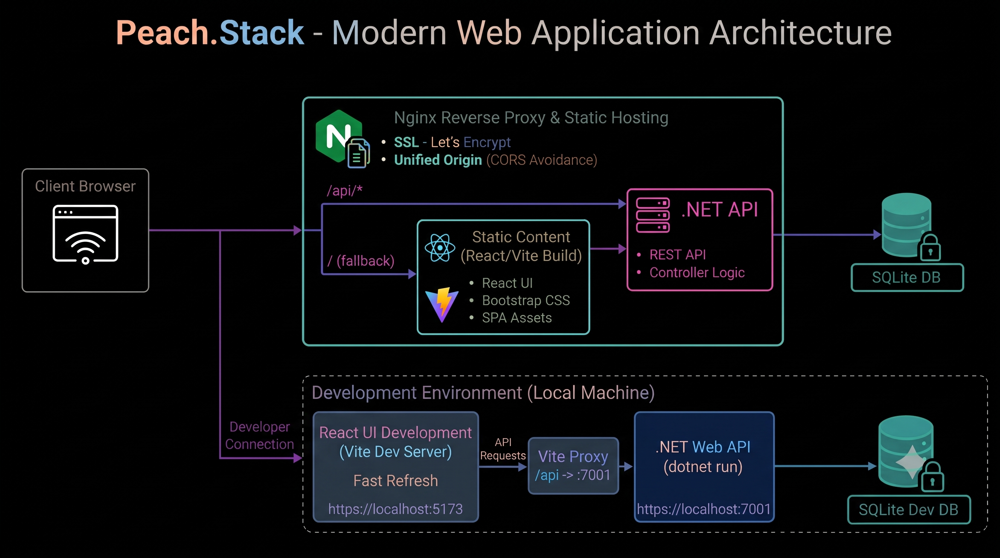

[](https://github.com/dahln/Peach.Stack/actions/workflows/BuildReleasePackages.yml)
[](https://github.com/dahln/Peach.Stack/actions/workflows/Deployment.yml)
[](https://github.com/dahln/Peach.Stack/actions/workflows/pr-validation.yml)
[](https://github.com/dahln/Peach.Stack/releases/latest)

**Demo**: https://web.dahln.com

## Overview

Peach.Stack is an opinionated .NET 11 + React starter template using a **decoupled proxy** architecture. This template includes all the things that I include in most of my projects - I created this template to streamline project creation for new projects and ideas.

The project, namespaces, folder, etc. use the 'Peach.Stack' naming convention - if you want to change this you can do a search and replace, or have Copilot do it; both approaches have worked for me.

## 2026 Announcement & Update

With the latest updates, I have decided to refocus this template project on React. Working with Blazor WASM is fun, and I'm passionate about Blazor. However, over the past 2 years the only Blazor work I have done has been my own 'passion projects', and even some of those projects are now in React. I'm rebranding the project to 'Peach.Stack', emphasizing that this is my preferred stack choice, at the moment. This rename will make future technology pivots more fluid. I have branched the current Blazor version and will keep that, and other archived branches, as a reference. Until recently my changes have been in another branch, and in order to finish the template restructuring I must now bring them into the master branch - your patience is appreciated while I finalize my current changes.

## Peach?

Peaches are delicious. And cheeky.

## Solution Layout

- `Peach.Stack.API`: ASP.NET Core Web API, controllers, and Identity endpoints
- `Peach.Stack.App`: React + Vite frontend
- `Peach.Stack.Service`: business logic and database orchestration
- `Peach.Stack.Database`: EF Core DbContext, entities, and migrations
- `Peach.Stack.Dto`: shared DTOs and enums
- `Peach.Stack.Test`: unit tests for service logic

Note: The API and frontend run as independent processes during development and are deployed as separate applications behind Nginx in production.



## Technologies

- .NET 11
- ASP.NET Core Web API
- React + Vite
- ASP.NET Core Identity with cookie auth and 2FA support
- Entity Framework Core + SQLite
- Bootstrap + Bootstrap Icons
- Scalar/OpenAPI in development

## Local Development - Quick Start

Two terminals are required.

### Terminal 1 - API

```
dotnet run --project Peach.Stack.API\Peach.Stack.API.csproj --launch-profile https
```

API runs at: **https://localhost:7001**  
Scalar API docs (dev only): **https://localhost:7001/scalar**

### Terminal 2 - Frontend

```
cd Peach.Stack.App
npm install        # first time only
npm run dev
```

Frontend runs at: **https://localhost:5173**

All `/api/*` requests from the frontend are proxied to `https://localhost:7001` by Vite - no CORS configuration needed.

### Trust the dev certificate (first time only)

```
dotnet dev-certs https --trust
```

### Open the app

Navigate to **https://localhost:5173**

The SQLite database is created and migrations are applied automatically on first API startup.

## Authentication And Email

Authentication uses ASP.NET Core Identity and stores user data in your database.

SMTP2GO is optional but recommended if you want email-driven flows such as:

- email confirmation
- password recovery
- email/username changes

Without SMTP configuration, the application still runs, but email-dependent account flows are limited.

## Database Commands

Run these from the solution root:

```
dotnet ef migrations add InitialCreate --project Peach.Stack.Database --startup-project Peach.Stack.API
```

```
dotnet ef database update --project Peach.Stack.Database --startup-project Peach.Stack.API
```

## Ignore Local App Settings Changes

If you want to keep local configuration changes out of git:

```
git update-index --assume-unchanged .\Peach.Stack.API\appsettings.json
```

To reverse it:

```
git update-index --no-assume-unchanged .\Peach.Stack.API\appsettings.json
```

## Deployment

Deployment runs through the `Deployment.yml` GitHub Actions workflow. It deploys automatically when a GitHub Release is published, and it also runs after `Build and Release Packages` completes successfully. You can still run it manually with `workflow_dispatch`: provide a `release_tag` to deploy a specific release, or leave `release_tag` empty to deploy the latest release.

`BuildReleasePackages.yml` deletes every existing GitHub Release and its tag immediately before publishing the next one. The repository intentionally keeps only the newest packaged release, so older release assets are not retained in GitHub Releases. This cleanup behaviour is easy to adjust by either removing the cleanup step, or adjusting the builds to target another branch or previous commit.

The workflow targets Fedora x64, downloads the release assets on the GitHub runner with the built-in `GITHUB_TOKEN`, uploads the packages to the server over SSH, and configures the server in place. No GitHub login or token is left on the server.

Before the first deployment:

1. Create the Fedora server.
2. Point your DNS record at the server IP and allow it to propagate.
3. Configure these repository secrets:

- `SERVERADDRESS`
- `SERVERPORT`
- `SERVERUSERNAME`
- `SERVERKEY`
- `APPLICATIONDOMAIN`
- `APPLICATIONNAME`
- `APPLICATIONUSER`
- `APPLICATIONAPIPORT`

The workflow derives the rest from `APPLICATIONNAME` and the standard deployment layout:

- Deploy root: `/opt/${APPLICATIONNAME,,}`
- API deploy path: `/opt/${APPLICATIONNAME,,}/api`
- App deploy path: `/opt/${APPLICATIONNAME,,}/app`
- systemd service: `kestrel-${APPLICATIONNAME,,}`
- Nginx site name: `${APPLICATIONNAME,,}`
- API executable: `${APPLICATIONNAME}.API`
- API release asset: `${APPLICATIONNAME}.API-{tag}-linux-x64.zip`
- App release asset: `${APPLICATIONNAME}.App-{tag}.zip`
- API route prefix: `/api`

The deployment workflow then:

- updates Fedora packages with `dnf`
- installs the required dependencies from the former Fedora installer
- configures `firewalld`
- creates the application system user when missing
- deploys the API and app packages with `rsync`
- verifies that `index.html` exists after app deployment
- creates or updates the systemd service
- creates or updates the Nginx site configuration
- enables SELinux proxy access for Nginx and labels the static app files for Nginx access
- provisions a Let's Encrypt certificate the first time `APPLICATIONDOMAIN` is set and SSL is not already configured

Subsequent releases update the deployed files and restart the service stack. Certificate setup is skipped after SSL is already configured.

The SSH user must be `root` or have passwordless `sudo`, because the workflow installs packages and writes system files non-interactively.

## License

This project uses the Unlicense. See `LICENSE` for the full text.

## Resources

- [Identity API with WebAPI](https://learn.microsoft.com/en-us/aspnet/core/security/authentication/identity-api-authorization?view=aspnetcore-8.0)
- [EF Core CLI](https://learn.microsoft.com/en-us/ef/core/cli/dotnet)
